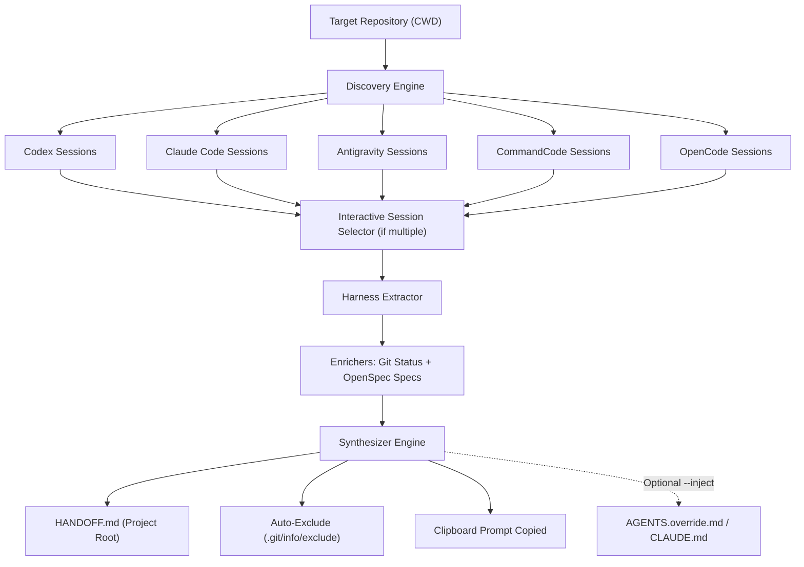

# 🔄 ai-handoff (`handoff`)

> Seamless cross-harness session discovery, extraction, and context handoff for AI coding environments.

When you're building software with AI coding assistants (OpenAI Codex, Claude Code, Google Antigravity, CommandCode, OpenCode), hitting a rate limit, quota threshold, or context degradation mid-task shouldn't mean losing your progress.

`ai-handoff` inspects your machine's session storage for the current repository, automatically extracts goals, completed steps, open loops, errors, and git status, and writes a crisp `HANDOFF.md` alongside an automatic clipboard prompt to resume immediately in your next AI harness.

---

## ⚡ Supported AI Harnesses

| Harness | Storage / Discovery Format | Extracted Details |
| :--- | :--- | :--- |
| **OpenAI Codex** | `~/.codex/sessions/**/rollout-*.jsonl`, `~/.codex/session_index.jsonl` | Goals, modified files, completed steps, open loops, token limit errors |
| **Claude Code** | `~/.claude/projects/<project-slug>/*.jsonl` | User prompts, tool calls, bash commands, file diffs, active status |
| **Google Antigravity** | `~/.gemini/antigravity/brain/<id>/.system_generated/logs/transcript.jsonl` | Workspace sessions, tool executions, file edits, conversation plans |
| **CommandCode** | `~/.commandcode/projects/<project-slug>/*.jsonl`, `*.meta.json` | Project sessions, command chains, file edits, errors |
| **OpenCode** | `opencode2 export` CLI or local storage | Session history, workspace context, status |

---

## 🚀 How It Works Under The Hood



1. **Discovery**: Scans local AI harness directories for sessions matching the project's root path. If multiple active sessions exist, an interactive prompt lets you choose which session to hand off from.
2. **Extraction**: Parses raw session JSONL logs to synthesize goals, executed commands, files modified/created, decisions made, and errors or limits reached.
3. **Enrichment**:
   - **Git Status**: Captures current branch, uncommitted modified files, untracked files, and recent commit messages.
   - **OpenSpec**: Captures active changes, task checklists, and specification statuses.
4. **Synthesis & Output**:
   - Generates a structured `HANDOFF.md` in the project root.
   - Adds `HANDOFF.md` to `.git/info/exclude` to guarantee it never accidentally pollutes git commits.
   - Copies a kickoff prompt directly to the OS clipboard:
     ```text
     I am switching AI assistants. Please read HANDOFF.md in the project root to resume context.
     ```
   - *(Optional `--inject`)*: Injects a delimited context block into `AGENTS.override.md` and `CLAUDE.md` for agents that read configuration files automatically.

---

## 📦 Installation

### Option 1: Install Globally via npm / pnpm / bun (Recommended)

You can install directly from GitHub without cloning:

```bash
# Using npm
npm install -g git+https://github.com/n4meless94/Multi-AI-Context.git

# Using pnpm
pnpm add -g git+https://github.com/n4meless94/Multi-AI-Context.git
```

Now `handoff` and `ai-handoff` will be available in your terminal globally.

### Option 2: Run directly with npx (No install needed)

```bash
npx github:n4meless94/Multi-AI-Context
```

### Option 3: From Source (For Developers)

```bash
# Clone the repository
git clone https://github.com/n4meless94/Multi-AI-Context.git
cd Multi-AI-Context

# Install dependencies and build
pnpm install
pnpm build

# Link globally to your system
npm link
# Or: pnpm link --global
```

---

## 🛠️ Usage

### 1. Basic Handoff
Run inside any project directory where you just used an AI coding assistant:

```bash
handoff
```

If multiple sessions are found for this project, an interactive menu lets you pick:
```text
◆  ai-handoff · Cross-Harness Session Handoff
│
◇  Multiple sessions found for this directory. Select source session:
│  ● [codex] fix user auth middleware (2 mins ago)
│  ○ [antigravity] implement payment gateway (15 mins ago)
│  ○ [claude] add dashboard analytics (1 hour ago)
└
```

`HANDOFF.md` will be created and the kickoff prompt will be copied to your clipboard. Simply open your next AI tool and press **Paste** (`Ctrl+V` / `Cmd+V`).

---

### 2. Specify Harness or Session ID
```bash
# Filter to Codex only
handoff -f codex

# Filter to Claude Code only
handoff -f claude

# By thread ID or deeplink
handoff codex://threads/01934c9f-33bc-7510-8b1b-83ee91e921d7
handoff 49c65775-4025-4346-b23b-23be18025b8c
```

---

### 3. Inject Context into Agent Config Files
If you're moving to an assistant that automatically reads root instructions (such as Antigravity or Claude Code):

```bash
handoff --inject
```

This injects the handoff summary into `AGENTS.override.md` and `CLAUDE.md`.

---

### 4. Cleanup When Done
Once your new AI assistant has picked up the context, clean up the temporary files and revert any injected blocks:

```bash
handoff clear
```

---

## 🧪 Testing

Run the test suite across extractors, enrichers, and end-to-end flows:

```bash
pnpm test
```

---

## 📄 License

MIT © [n4meless94](https://github.com/n4meless94)
